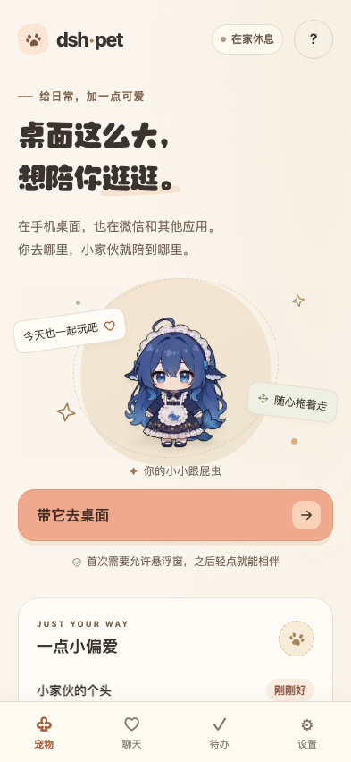
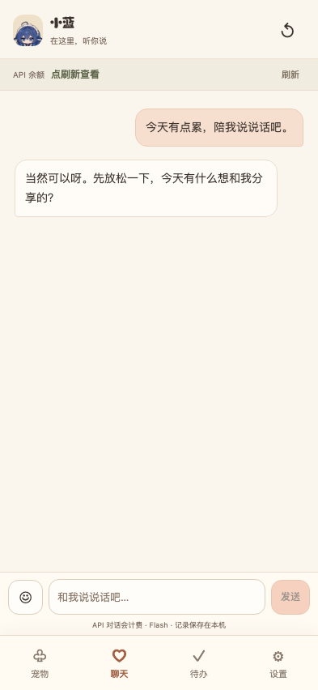
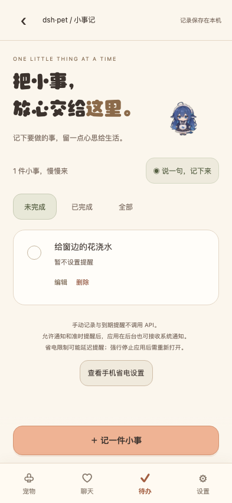
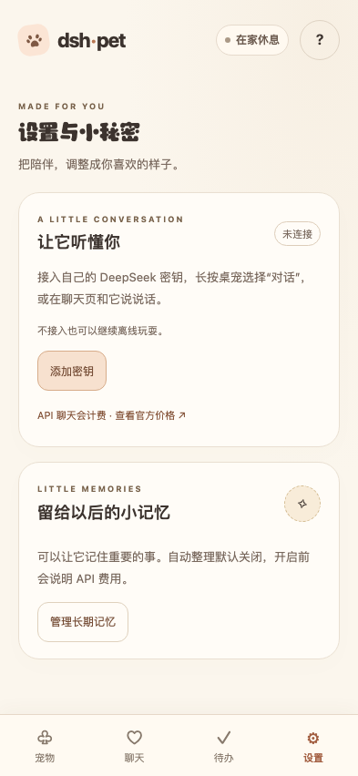

# dsh-pet Android

**把一只小小的桌宠，带到手机桌面。**

基于 [PC2005-cloud/dsh-pet](https://github.com/PC2005-cloud/dsh-pet) 改造的第三方 Android 手机应用。小家伙可以悬浮在桌面和其他应用上，陪你聊天、记录待办，也能按你写的人设和你相处。

`Android 8.0+` · `离线桌宠` · `可选 DeepSeek API` · `预览测试版`

[界面预览](#界面预览) · [功能介绍](#功能介绍) · [开始使用](#开始使用) · [构建 APK](#构建-apk) · [隐私与计费](#隐私与计费) · [来源与授权](#来源与授权)

> 本项目保留上游原角色、109 段动画与互动核心，并添加 Android 适配。不同手机上的悬浮拖动、输入法和后台提醒仍需真机验证。原角色和素材有**非商业使用限制**，请查看文末授权说明。

## 界面预览

| 宠物 · 带它去桌面 | 聊天 · 分享日常与心情 |
| :---: | :---: |
|  |  |
| **待办 · 记下小事和提醒** | **设置 · 安排你的陪伴方式** |
|  |  |

截图使用模拟数据，界面可能随版本略有变化。

## 功能介绍

### 在桌面陪你

- **悬浮桌宠**：可显示在手机桌面与其他普通应用上，支持拖动、甩抛、长按动作菜单及睡眠唤醒。基础互动可离线使用。
- **四个页面**：宠物、聊天、待办、设置，各自管理常用操作。
- **角色设置**：保留一只可编辑角色，按身份背景、性格喜好、关系、说话习惯、原则和示例对话填写；人设正文与分类合计最多 10000 字。

### 聊天与陪伴

- **DeepSeek 聊天**：输入自己的 API 密钥后可在 App 内聊天，支持流式回复、停止、重试，以及内置表情包和普通 Emoji。密钥接入前会显示计费提醒。
- **情绪与好感度**：可查看、调整、重置或关闭自动变化。自动判断复用当次聊天回复，不单独发起请求，但会增加少量用量；判断可能不准确。
- **长期记忆**：用户确认开启后，每 10 轮聊天单独整理一次，每滚动一小时最多 3 次；支持查看、修改、删除和关闭。整理和后续携带记忆会产生额外用量，后台任务可能延迟。
- **可选陪伴**：碎碎念、睡眠梦话、原版配图和聊天动作。定时自动陪伴默认关闭，开启前会说明计费；全部宠物合计每滚动一小时最多 12 次自动请求，次数上限不等于金额上限。

### 记录生活小事

- **待办与通知**：待办保存在本机，可添加、编辑、完成、删除和设置到期提醒。按提示开启通知及准时提醒；也可主动打开手机时钟设置独立闹钟。
- **语音与 AI 草稿**：通过系统语音或打字输入原话，再由你手动选择 AI 整理。草稿支持检查和修改，确认后才保存；语音识别不会自动调用 AI。

本项目不包含完整 DeepSeek-Harness 宿主，也不提供 DSH 会话、其他插件联动、原宿主语音合成或电脑截屏等能力。

## 开始使用

1. 安装测试 APK，打开 **dsh-pet 桌宠**。项目最低支持 Android 8.0（API 26），并需要可播放 VP9-alpha WebM 的 Android System WebView。
2. 在「宠物」页点 **带它去桌面**，按系统提示允许悬浮窗。长按宠物可打开手机菜单。
3. 如需聊天或查询余额，在「设置」中添加自己的 DeepSeek API 密钥，并先阅读计费提示。密钥请只输入自己的手机，不要提交到仓库或 Issue。
4. 如需到期通知，为待办设置时间并按提示开启通知及准时提醒。手机省电、关机或强行停止应用可能影响送达。

使用「手机时钟」时还需在时钟中确认。时钟里的闹钟与待办独立管理，修改或删除待办不会同步修改闹钟。语音服务依赖手机上的系统服务与语言包，不可用时可打字或使用输入法语音。

## 构建 APK

用 Android Studio 打开项目根目录。工程需要 SDK 37、AGP 9.4.1、Gradle Wrapper 9.6.0、Node.js 24+，以及与 Gradle/AGP 兼容的 JDK。

```sh
npm --prefix android ci --ignore-scripts --no-audit --no-fund
./gradlew :app:assembleDebug --no-daemon --max-workers=1
```

依赖已缓存时，Gradle 命令可加 `--offline`。构建输出位于 `app/build/outputs/apk/debug/app-debug.apk`；也可通过 Android Studio 的 Build 菜单生成 APK。构建配置使用单 worker，不需要转码视频或运行本地模型。

测试 APK 使用调试签名，仅供安装验证；正式分发需要自行管理发布签名。详细说明和真机验收步骤见 [Android 构建与验收说明](README_ANDROID.md)。

## 隐私与计费

API 密钥、聊天记录、角色设置、情绪、长期记忆和待办加密保存在手机的应用私有存储中。聊天时，当前输入、角色设定、必要的近期对话及部分长期记忆会发送给 DeepSeek；系统语音服务可能联网处理音频。详见 [隐私说明](PRIVACY.md)。

情绪自动变化默认开启，可在宠物页关闭；长期记忆自动整理和定时陪伴需要另行开启。API 实际费用以官方账单为准，停止或取消请求后，已发生的用量仍可能计费。

自动测试使用模拟数据，不代表所有手机、输入法、系统权限、后台通知或真实 API 账户均已验证。发布前待验收事项见 [发布前检查](RELEASE_REVIEW.md)。

## 来源与授权

本项目基于 [PC2005-cloud/dsh-pet](https://github.com/PC2005-cloud/dsh-pet) 的固定提交 `cc498c3be921ace27a8eca72626759a107c3d672` 改造。原角色与动画并非本项目原创，感谢原作者 PC2005-cloud。

上游代码采用 MIT 授权，见 [项目 LICENSE](LICENSE) 与 [上游 LICENSE](dshgit/LICENSE)。**原角色、动画和素材有独立授权，原项目标注的形象授权为 CC BY-NC-SA 4.0，限非商业使用；代码的 MIT 授权不代表素材可商业使用。** 更多来源及授权说明见 [第三方声明](THIRD_PARTY_NOTICES.md)。
